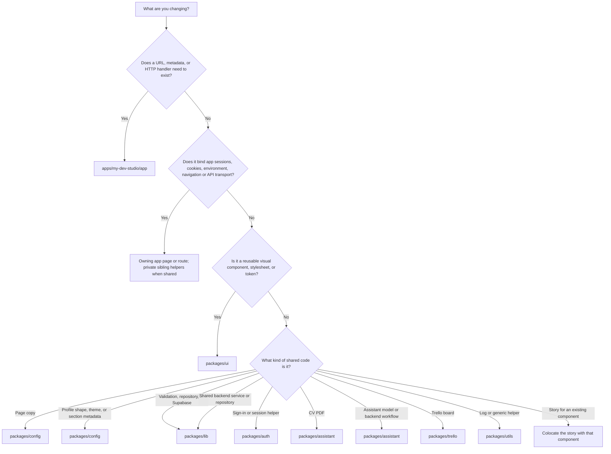

# Working on MyDevStudio

MyDevStudio is a multiuser portfolio and CV platform in the `devhub-showcase` repository. These instructions apply throughout the repository. Read the files you are changing before editing them, and preserve unrelated work.

## Confirm the checkout

The user's primary local checkout is `/Users/yusufyilmaz/code/freelance/projects/devhub-showcase-1`. Before editing, verify `pwd`, `git rev-parse --show-toplevel`, and `git status --short`. Use this checkout unless the user explicitly selects another checkout or worktree. A ChatGPT project mirror or another folder named `devhub-showcase` is not interchangeable with it.

Preserve existing staged and unstaged work. Apply only the requested changes; do not copy whole files from another checkout without comparing them. Do not stage, commit, or publish changes unless requested. Report verification from the checkout where it actually ran.

## Apps and packages

Workspace members are `apps/*`, `packages/*`, and `tools/*`. The Next.js app package name is `my-dev-studio`. Shared packages use the `@shared/*` name. There is no `apps/web` package.

| Location                 | Name                    | Responsibility                                                                |
| ------------------------ | ----------------------- | ----------------------------------------------------------------------------- |
| `apps/my-dev-studio`     | `my-dev-studio`         | Next.js routes, API handlers, and feature data access                         |
| `apps/my-fitness-app`    | `my-fitness-app`        | Fitness OS app. Task rows share the Supabase project and Auth users           |
| `apps/storybook-app`     | `storybook-app`         | Storybook for `packages/ui`                                                   |
| `packages/ui`            | `@shared/ui`            | Controls, sections, studio and portfolio surfaces, theme, and global CSS      |
| `packages/config`        | `@shared/config`        | Profile types, themes, section metadata, and page copy including the home FAQ |
| `packages/lib`           | `@shared/lib`           | Shared services, repositories, schemas, database clients and Redis cache      |
| `packages/auth`          | `@shared/auth`          | Session helpers and Google sign-in                                            |
| `packages/notifications` | `@shared/notifications` | Web push delivery and notification helpers                                    |
| `packages/assistant`     | `@shared/assistant`     | Assistant/chat/companion, portfolio/studio compositions and CV rendering      |
| `packages/runtime`       | `@shared/runtime`       | Shared runtime helpers, including notifications                               |
| `packages/utils`         | `@shared/utils`         | Logging and other shared utilities                                            |
| `packages/trello`        | `@shared/trello`        | Trello board UI                                                               |

App routes stay in `apps/my-dev-studio/app`. Page-specific identity, cookie, environment and transport wiring is colocated with its owner under `apps/my-dev-studio/app`. Use private sibling modules for bindings shared by a route family. Shared backend services and repositories live in `@shared/lib`; chat and assistant workflows live in `@shared/assistant`. That app has no `lib` folder.

| Feature      | Owns                                                                           |
| ------------ | ------------------------------------------------------------------------------ |
| `admin`      | Workspace auth, session handlers, Google profile import, owner edit link       |
| `billing`    | Stripe gateway, billing client, pricing, premium configuration, account status |
| `management` | Managed portfolios and their API helpers                                       |

Import portable UI from `@shared/ui`. Do not add a feature file that only re-exports a shared component. Do not move auth, database access, or route handlers into `packages/ui`. Pass fetching and navigation in from the app.

## Services and utilities

`@shared/lib` owns service and repository implementations, organized by layer under `packages/lib/src`: `db/`, `repositories/`, `services/`, `types/`, and `schemas/`. Within `services/` and `repositories/`, group implementations and tests into domain folders instead of placing every file at the layer root. Keep shared database code under `db/`. See [packages/lib/CATALOG.md](packages/lib/CATALOG.md).

`@shared/lib` also owns profile/section validation, typed database clients and database/chat models. Generic helpers belong in `@shared/utils`; localized portfolio copy and formatting remain in `@shared/config`.

Do not add a file in one package that only re-exports another package’s implementation, especially through relative paths into a sibling folder (for example a feature module that only forwards another package’s implementation). That creates a hidden dependency, breaks package boundaries, and invites cyclic workspace deps. Import the owning package export instead (`@shared/lib/profile`, `@shared/lib/profile-repository`, and so on). When code changes ownership, update package exports, dependencies and callers together; do not leave forwarding packages or compatibility shims.

### Package export paths

In each workspace package’s `package.json` `exports`, prefer shallow public entry points. Use at most **two** path segments after the package name:

- One segment: `@shared/lib/types`, `@shared/lib/profile`, `@shared/lib/fitness`
- Two segments: `@shared/lib/repositories/workspace`, `@shared/lib/db/client` (with `./db/*` mapping to files under `src/db/`)

Do **not** add deep export keys or tsconfig path aliases such as `@shared/lib/types/supabase/database.types` or `@shared/lib/fitness/task/service/task-service`. Expose implementations through shallow layer entry points (`./services/task`, `./repositories/profile`) or a package barrel (`./types`, `./schemas`, `./fitness`). Import `Database`, `Json`, and row types from `@shared/lib/types`, not from generated file paths.

## Reuse shared UI

Always build interface from `packages/ui`. Check [packages/ui/CATALOG.md](packages/ui/CATALOG.md) before writing markup. Primitive controls, layout, theme tokens and global CSS live there. Assistant/chat/companion, studio and portfolio compositions live in `packages/assistant`, including sections, examples and CV rendering. Import feature surfaces from their declared `@shared/assistant/*` entry points. Import a control as `@shared/ui/{folder}`.

Do not create one-off components from plain HTML elements in app routes, features, or other packages. Homepage blocks live in `packages/assistant/src/components/sections/home-section` and compose the shared controls.

If the catalog has no component that fits, add it in `packages/ui`. All workspace `CATALOG.md` files are generated. Edit the package's `catalog.template.md` for authored guidance, or `package.json`/source exports for the generated reference, then run `pnpm generate:catalogs`. UI registry sections still use `packages/ui/src/registry/components.json`. Do not hand-edit generated catalogs; verify with `pnpm check:catalogs`. Use `--package @shared/ui` to select one package.

## Keep feature descriptions current

- Use [the feature inventory](docs/features.md) to verify what the homepage and README advertise. Describe configuration requirements for AI, scheduled discovery, browser push, LinkedIn email forwarding and Stripe test checkout.
- Homepage routing and metadata live under `apps/my-dev-studio/app`. The homepage FAQ uses `packages/config/src/copy/site-copy/faq.ts`. Keep it aligned with the visible feature cards and product documentation.
- Portfolio setup and the companion are shared Studio compositions. Studio account preferences use `/api/account-preferences` and are separate from saved portfolio appearance.
- Job Hunter UI lives in `packages/assistant/src/components/portfolio/jobs`. The app owns `/admin/jobs`, `/api/jobs` and the inbound email and scheduled worker routes. Shared listing and email parsing code lives in `packages/lib/src/services/jobs`. See the [Job Hunter guide](docs/testing/manual/job-hunter.md) and [LinkedIn alert guide](docs/testing/manual/linkedin-job-alerts.md).

## Where code goes

Follow the first matching question. Stop at the first yes.



Admin, billing and management integrations may keep their existing feature modules. Home, reviews, portfolio, platform and chat bindings belong beside their owning app pages/routes.

A component that needs data receives that data, or a request function, from the feature. The component does not choose the API URL. Colocate app-specific bindings with their page or route; keep reusable domain logic in its shared package. Do not recreate removed home, reviews, portfolio, platform or chat feature folders.

## AI lookup guide — find relevant references

Use the read-only lookup CLI to find relevant context before opening large catalogs, skills, documentation or design references. Run from the repository root with Node 24.15+ (below 25) and pnpm 11:

```sh
pnpm --silent lookup catalog "button" --package @shared/ui --limit 2
pnpm --silent lookup symbol Button --package @shared/ui
pnpm --silent lookup skills "workspace" --limit 2
pnpm --silent lookup docs "revision conflicts" --limit 2
pnpm --silent lookup design "spacing" --limit 1
```

Queries use lexical AND matching: use a few specific keywords. Follow `hasMore` with `--cursor`, or retrieve a result/locator with `lookup section '<id>' --max-tokens 4000`. A budget failure is not evidence that a reference is absent. Always read mandatory instructions and the relevant source contracts; catalog excerpts are discovery context. Use `--max-tokens` to bound the final output and `--package` to narrow catalog ownership. Catalog rows do not prove that an import works; verify declared symbols and source contracts. Catalogs are generated from [tools/cli/catalog/templates/package.md.hbs](tools/cli/catalog/templates/package.md.hbs). See the [AI quick start](.agents/README.md) and [full CLI usage](tools/cli/README.md#token-bounded-repository-lookup).

## Skills and repository checks

Canonical skills live in `.agents/skills`. `.cursor/skills` and `.claude/skills` are links to that directory, not a second copy.

```sh
pnpm cli:skills symlink --dry-run
pnpm cli:skills validate
pnpm cli:skills scaffold my-skill --description "When to use this skill"
pnpm cli:check links
pnpm cli:check catalogs
pnpm cli:check exports
pnpm cli:check lint
pnpm cli:check docs
pnpm cli:check skills
pnpm cli:check types
pnpm cli:check unused
pnpm cli:check secrets
```

`validate` checks skill frontmatter, duplicate names, local links, and advisory file size. A skill file over 800 lines or 65536 bytes is reported and does not fail the check. Placeholders such as TODO, FIXME, and TBD are reported the same way. `scaffold` writes `SKILL.md`, `workflows/overview.md`, and `references/overview.md` and does not replace an existing skill. `cli:check` runs the checks this repository already owns. `secrets` looks for private keys and live tokens in the tree. It does not install Gitleaks or a duplicate-code scanner. `pnpm check:skills` uses the same validator.

## Dev environment

Use the Node and pnpm versions in the root `package.json` (currently Node 24.15+ below 25, and pnpm 11). Check the active versions before installing or running checks. Install with `pnpm install --frozen-lockfile`. External dependencies use `catalog:`. Internal dependencies use `workspace:*`. Change the catalog, the package manifest, and the lockfile together.

- Studio dev server: `pnpm --filter my-dev-studio dev` (port 3001)
- Fitness dev server: `pnpm --filter my-fitness-app dev` (port 3002)
- Targeted builds: `pnpm build:studio` and `pnpm build:fitness`
- One package: `pnpm --filter <package-name> <script>`
- Storybook: `pnpm --filter storybook-app storybook`
- Clear the Storybook optimizer cache: `pnpm --filter storybook-app storybook:clean`
- Stop Storybook: `pnpm --filter storybook-app storybook:kill`
- Workspace check: `node .agents/skills/mydevstudio-development/scripts/check-workspace.mjs`

Lint and format with Biome. Do not add ESLint. Do not relax Biome or TypeScript rules to get a green check. Do not hand-edit generated Next.js files.

Read the matching skill before a large change:

- [Development](.agents/skills/mydevstudio-development/SKILL.md)
- [Business rules](.agents/skills/mydevstudio-business/SKILL.md)
- [Sections](.agents/skills/mydevstudio-sections/SKILL.md)

When the change is inside one package or app, also read that package skill:

| Area                 | Skill                                                                                    |
| -------------------- | ---------------------------------------------------------------------------------------- |
| `packages/ui`        | [Developing the UI package](.agents/skills/developing-ui-package/SKILL.md)               |
| `packages/config`    | [Developing the config package](.agents/skills/developing-config-package/SKILL.md)       |
| `packages/lib`       | [Developing the lib package](.agents/skills/developing-lib-package/SKILL.md)             |
| `packages/auth`      | [Developing the auth package](.agents/skills/developing-auth-package/SKILL.md)           |
| `packages/assistant` | [Developing the assistant package](.agents/skills/developing-assistant-package/SKILL.md) |
| `packages/runtime`   | [Developing the runtime package](.agents/skills/developing-runtime-package/SKILL.md)     |
| `packages/utils`     | [Developing the utils package](.agents/skills/developing-utils-package/SKILL.md)         |
| `packages/trello`    | [Developing the Trello package](.agents/skills/developing-trello-package/SKILL.md)       |
| `apps/my-dev-studio` | [Developing the MyDevStudio app](.agents/skills/developing-my-dev-studio-app/SKILL.md)   |
| `apps/storybook-app` | [Developing the Storybook app](.agents/skills/developing-storybook-app/SKILL.md)         |

Use [features](docs/features.md), [architecture](docs/architecture.md), [conventions](docs/conventions.md), [testing](docs/testing.md), and [DESIGN.md](DESIGN.md). Check the matching catalog before adding a public export:

| Package     | Catalog                                                        | Check it before adding                      |
| ----------- | -------------------------------------------------------------- | ------------------------------------------- |
| `ui`        | [packages/ui/CATALOG.md](packages/ui/CATALOG.md)               | A control, section, surface, or stylesheet  |
| `config`    | [packages/config/CATALOG.md](packages/config/CATALOG.md)       | A profile field, theme, or section metadata |
| `lib`       | [packages/lib/CATALOG.md](packages/lib/CATALOG.md)             | A domain service or repository              |
| `auth`      | [packages/auth/CATALOG.md](packages/auth/CATALOG.md)           | A sign-in or session helper                 |
| `cv`        | [packages/assistant/CATALOG.md](packages/assistant/CATALOG.md) | CV PDF rendering                            |
| `assistant` | [packages/assistant/CATALOG.md](packages/assistant/CATALOG.md) | An assistant model or message               |
| `runtime`   | [packages/runtime/CATALOG.md](packages/runtime/CATALOG.md)     | A shared browser or fetch helper            |
| `utils`     | [packages/utils/CATALOG.md](packages/utils/CATALOG.md)         | A logger or generic helper                  |
| `trello`    | [packages/trello/CATALOG.md](packages/trello/CATALOG.md)       | Trello board UI or a Trello client          |

## Environment configuration

Each app owns a T3/Zod module: `apps/my-dev-studio/env.ts` and `apps/my-fitness-app/env.ts`. Import the matching module in app runtime code instead of reading `process.env` directly. Use relative imports unless the app's TypeScript configuration explicitly supports the alias.

Add settings to the appropriate `server` or `client` schema and the app's `.env.example` together. Public settings also need explicit `process.env.NEXT_PUBLIC_*` entries in `experimental__runtimeEnv` so Next.js can bundle them. Only intentionally public values belong in `client`; credentials stay in `server`.

Copy examples into each app's `.env.local` for local credentials. Never overwrite existing local env files or copy real credentials into examples, logs, or documentation. Next.js loads env files; standalone scripts must load their environment explicitly.

Optional integrations remain optional. Empty strings normalize to `undefined`; flags and numeric limits remain strings. Preserve feature availability checks and existing fallback values. Validation occurs when the module is imported; do not claim explicit build-time validation unless it is wired into the build configuration.

Shared packages must not import either app's env module. Existing package-level env access and standalone tooling have separate lifecycles; migrate them deliberately through package-owned schemas or injected configuration. Tests that vary configuration should mock the app env boundary; keep schema validation tests against the real module. See [environment module verification](docs/testing/manual/environment-modules.md).

## Storybook deployment

Use `pnpm --filter storybook-app build-storybook`; the static output is `apps/storybook-app/storybook-static`. The separate [Pages workflow](.github/workflows/deploy-storybook.yml) builds and deploys on matching pushes to `main` or a manual run from `main`. Pages must use GitHub Actions as its publishing source. Keep deployed stories based on fictional fixtures; do not include production credentials or private data. When changing asset paths, verify both the Storybook manager and iframe under the repository subpath.

## Data and security

Keep authorization on the server. A client-supplied id, username, or profile field is not authority. Keep each owner's records isolated. A missing or private profile must not fall back to someone else's content. Respect revision conflicts.

Update types, validators, save and import boundaries, and rendering together when a persisted field changes. Keep compatibility for documents that omit the field.

Do not publish profiles, transfer ownership, assign roles, run production migrations, or change production data as a side effect of code work. Do not commit credentials or private exports. Do not log CV content, prompts, tokens, or raw request bodies. See [SECURITY.md](SECURITY.md).

## Testing

CI is [`.github/workflows/ci.yml`](.github/workflows/ci.yml). It verifies code checks, unit tests, Storybook and production builds. The separate [browser workflow](.github/workflows/e2e.yml) runs only on pushes to `main` and does not block deployment.

Put each unit test next to the file it covers, with the same base name: `admin-login.tsx` and `admin-login.test.tsx` live in the same folder. A Storybook story for that component is `admin-login.stories.tsx` in that folder too. The same naming applies to modules (`user-profile.ts` and `user-profile.test.ts`) and route handlers (`route.ts` and `route.test.ts`).

Unit tests start with `describe`. Keep `beforeEach`, `afterEach`, and `it` inside that suite. Helpers that are not tests stay at module scope.

- Full local gate: `pnpm check` and `pnpm test`
- App types: `pnpm --filter my-dev-studio typecheck` and `pnpm --filter my-fitness-app typecheck`
- One file: `pnpm exec vitest run --project unit packages/ui/src/theme/ThemeProvider.test.tsx`
- Studio browser tests: `pnpm test:e2e:studio`
- Fitness browser tests: `pnpm test:e2e:fitness`
- Install browser dependencies first with `pnpm exec playwright install chromium`. Browser suites live in `apps/my-dev-studio/e2e` and `apps/my-fitness-app/e2e`.

Browser tests use local fixtures, not production accounts. If a required check cannot run, say what blocked it. Do not invent test output.

### Required manual feature documentation

For every new or changed feature, add or update a dedicated guide under [`docs/testing/manual/`](docs/testing/manual/index.md) and its entry in the [manual testing index](docs/testing/manual/index.md), in the same PR as the feature. This applies to UI, API, permission, integration and workflow behavior. Do not consider a feature ready for review without this documentation.

Use the [guide template](docs/testing/manual/template.md). Each feature guide must identify scope/status, account/fixture/configuration prerequisites and numbered steps. **Every step must contain a clickable full URL, the matching route path, the exact action/control, expected result and actual result/evidence.** Tabs use the real parent page route; never invent routes for tabs. Include persistence, failure/retry/conflict and owner/other-user/signed-out or public/private checks where applicable.

When a roadmap task has a reviewable implementation, add or update its Notion **How to test** section using the dedicated guide: clickable URLs, route paths, prerequisites, actions, expected results, actual evidence and PR/guide links. Preserve task requirements and do not mark deployed verification complete from local tests. If Notion access or workspace limits block the update, record the pending task links and do not repeatedly retry an entitlement failure.

Use disposable accounts and fictional content. Distinguish preview/local/manual/provider/deployed verification; leave unexecuted steps **Not run** and mark blocked prerequisites explicitly. Partial features must state what is unfinished. Never claim live integration or production migration verification from fixtures or a green CI run. Link each feature guide in the PR's per-feature testing section and maintain older instructions when behavior changes.

## Pull requests

Keep the change focused. Review the diff for unrelated files and secrets. Update docs when a command, package boundary, or user-facing behavior changes.

Run `pnpm check` and `pnpm test` before opening the PR. For app UI or route changes, also run `pnpm --filter my-dev-studio build` when the change can affect the production build. Say which checks actually ran.

Shared backend modules must not import an app or its environment schema. App adapters bind shared factories to validated configuration, verified identity callbacks and cookie/response handling. Preserve owner filters, publication checks, origin checks, attempt limits and revision guards when extracting backend code. Do not add pure re-export shims in app features.
