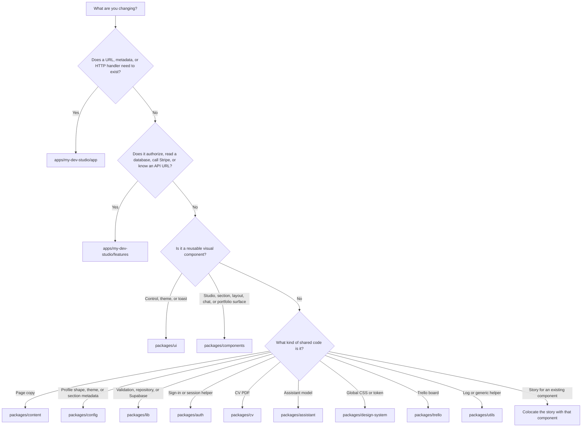
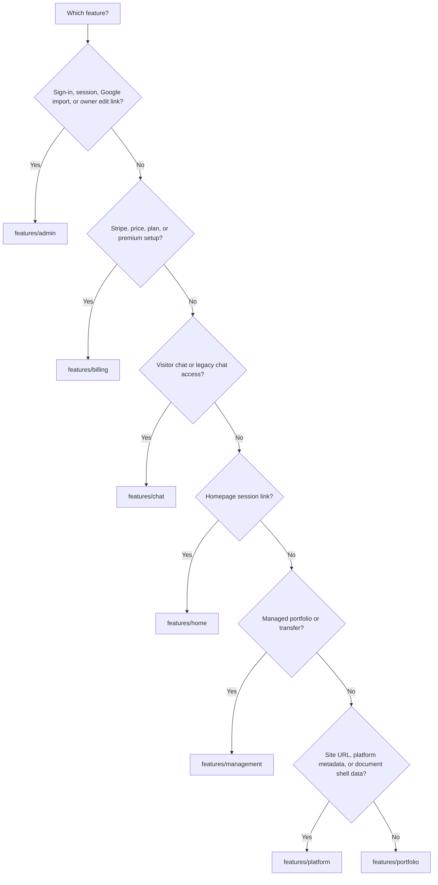

# Working on MyDevStudio

MyDevStudio is a multiuser portfolio and CV platform in the `devhub-showcase` repository. These instructions apply throughout the repository. Read the files you are changing before editing them, and preserve unrelated work.

## Apps and packages

Workspace members are `apps/*`, `packages/*`, and `tools/*`. The Next.js app package name is `my-dev-studio`. Shared packages use the `@shared/*` name. There is no `apps/web` package.

| Location                 | Name                    | Responsibility                                                      |
| ------------------------ | ----------------------- | ------------------------------------------------------------------- |
| `apps/my-dev-studio`     | `my-dev-studio`         | Next.js routes, API handlers, and feature data access               |
| `apps/my-fitness-app`    | `my-fitness-app`        | Fitness OS app. Task rows share the Supabase project and Auth users |
| `apps/storybook-app`     | `storybook-app`         | Storybook for `packages/ui` and `packages/components`               |
| `packages/components`    | `@shared/components`    | Portable studio UI, sections, layout, chat, and portfolio surfaces  |
| `packages/ui`            | `@shared/ui`            | Primitive controls, theme provider, and notification provider       |
| `packages/config`        | `@shared/config`        | Profile types, themes, and section metadata                         |
| `packages/content`       | `@shared/content`       | Page copy, including the home FAQ                                   |
| `packages/lib`           | `@shared/lib`           | Validation, repositories, Supabase access, and domain services      |
| `packages/auth`          | `@shared/auth`          | Session helpers and Google sign-in                                  |
| `packages/cv`            | `@shared/cv`            | CV PDF rendering                                                    |
| `packages/assistant`     | `@shared/assistant`     | Portfolio and editing assistants                                    |
| `packages/cache`         | `@shared/cache`         | Cache integrations                                                  |
| `packages/runtime`       | `@shared/runtime`       | Shared runtime helpers, including notifications                     |
| `packages/utils`         | `@shared/utils`         | Logging and other shared utilities                                  |
| `packages/design-system` | `@shared/design-system` | Global CSS and design tokens                                        |
| `packages/trello`        | `@shared/trello`        | Trello board UI                                                     |

App routes stay in `apps/my-dev-studio/app`. App-only data access stays in `apps/my-dev-studio/features/<feature>`. That app has no `lib` folder.

| Feature      | Owns                                                                            |
| ------------ | ------------------------------------------------------------------------------- |
| `admin`      | Workspace auth, session handlers, Google profile import, owner edit link        |
| `billing`    | Stripe gateway, billing client, pricing, premium configuration, account status  |
| `chat`       | Visitor chat and legacy portfolio chat access                                   |
| `home`       | Home session links                                                              |
| `management` | Managed portfolios and their API helpers                                        |
| `platform`   | Site URL, platform metadata, page presentation, document request client         |
| `portfolio`  | Published and public profiles, metadata, branding, CV responses, page resources |

Import portable UI from `@shared/components` (`studio`, `layout`, `portfolio`, `sections`). Do not add a feature file that only re-exports a shared component. Do not move auth, database access, or route handlers into `packages/components`. Pass fetching and navigation in from the app.

## Where code goes

Follow the first matching question. Stop at the first yes.

When the answer is `features/`, pick the folder by subject:

A component that needs data receives that data, or a request function, from the feature. The component does not choose the API URL. A route file stays thin and calls the feature.

## Dev environment

Use the Node and pnpm versions in the root `package.json`. Install with `pnpm install --frozen-lockfile`. External dependencies use `catalog:`. Internal dependencies use `workspace:*`. Change the catalog, the package manifest, and the lockfile together.

- App dev server: `pnpm --filter my-dev-studio dev`
- One package: `pnpm --filter <package-name> <script>`
- Storybook: `pnpm --filter storybook-app storybook`
- Clear the Storybook optimizer cache: `pnpm --filter storybook-app storybook:clean`
- Stop Storybook: `pnpm --filter storybook-app storybook:kill`
- Workspace check: `node .agents/skills/mydevstudio-development/scripts/check-workspace.mjs`

Lint and format with Biome. Do not add ESLint. Do not relax Biome or TypeScript rules to get a green check. Do not hand-edit generated Next.js files.

Read the matching skill before a large change:

- [Development](.agents/skills/mydevstudio-development/SKILL.md)
- [Business rules](.agents/skills/mydevstudio-business/SKILL.md)
- [Sections](.agents/skills/mydevstudio-sections/SKILL.md)

When the change is inside one package or app, also read that package skill:

| Area                     | Skill                                                                                            |
| ------------------------ | ------------------------------------------------------------------------------------------------ |
| `packages/ui`            | [Developing the UI package](.agents/skills/developing-ui-package/SKILL.md)                       |
| `packages/components`    | [Developing the components package](.agents/skills/developing-components-package/SKILL.md)       |
| `packages/config`        | [Developing the config package](.agents/skills/developing-config-package/SKILL.md)               |
| `packages/content`       | [Developing the content package](.agents/skills/developing-content-package/SKILL.md)             |
| `packages/lib`           | [Developing the lib package](.agents/skills/developing-lib-package/SKILL.md)                     |
| `packages/auth`          | [Developing the auth package](.agents/skills/developing-auth-package/SKILL.md)                   |
| `packages/cv`            | [Developing the CV package](.agents/skills/developing-cv-package/SKILL.md)                       |
| `packages/assistant`     | [Developing the assistant package](.agents/skills/developing-assistant-package/SKILL.md)         |
| `packages/cache`         | [Developing the cache package](.agents/skills/developing-cache-package/SKILL.md)                 |
| `packages/runtime`       | [Developing the runtime package](.agents/skills/developing-runtime-package/SKILL.md)             |
| `packages/utils`         | [Developing the utils package](.agents/skills/developing-utils-package/SKILL.md)                 |
| `packages/design-system` | [Developing the design-system package](.agents/skills/developing-design-system-package/SKILL.md) |
| `packages/trello`        | [Developing the Trello package](.agents/skills/developing-trello-package/SKILL.md)               |
| `apps/my-dev-studio`     | [Developing the MyDevStudio app](.agents/skills/developing-my-dev-studio-app/SKILL.md)           |
| `apps/storybook-app`     | [Developing the Storybook app](.agents/skills/developing-storybook-app/SKILL.md)                 |

Use [features](docs/features.md), [architecture](docs/architecture.md), [conventions](docs/conventions.md), [testing](docs/testing.md), and [DESIGN.md](DESIGN.md). Check the matching catalog before adding a public export:

| Package         | Catalog                                                                | Check it before adding                        |
| --------------- | ---------------------------------------------------------------------- | --------------------------------------------- |
| `components`    | [packages/components/CATALOG.md](packages/components/CATALOG.md)       | A section, editor, chat, or portfolio surface |
| `ui`            | [packages/ui/CATALOG.md](packages/ui/CATALOG.md)                       | A primitive control, theme, or toast          |
| `config`        | [packages/config/CATALOG.md](packages/config/CATALOG.md)               | A profile field, theme, or section metadata   |
| `content`       | [packages/content/CATALOG.md](packages/content/CATALOG.md)             | Page copy                                     |
| `lib`           | [packages/lib/CATALOG.md](packages/lib/CATALOG.md)                     | Validation, a repository, or a domain service |
| `auth`          | [packages/auth/CATALOG.md](packages/auth/CATALOG.md)                   | A sign-in or session helper                   |
| `cv`            | [packages/cv/CATALOG.md](packages/cv/CATALOG.md)                       | CV PDF rendering                              |
| `assistant`     | [packages/assistant/CATALOG.md](packages/assistant/CATALOG.md)         | An assistant model or message                 |
| `cache`         | [packages/cache/CATALOG.md](packages/cache/CATALOG.md)                 | A cache client or rate limit                  |
| `runtime`       | [packages/runtime/CATALOG.md](packages/runtime/CATALOG.md)             | A shared browser or fetch helper              |
| `utils`         | [packages/utils/CATALOG.md](packages/utils/CATALOG.md)                 | A logger or generic helper                    |
| `design-system` | [packages/design-system/CATALOG.md](packages/design-system/CATALOG.md) | Global CSS or a design token                  |
| `trello`        | [packages/trello/CATALOG.md](packages/trello/CATALOG.md)               | Trello board UI or a Trello client            |

## Data and security

Keep authorization on the server. A client-supplied id, username, or profile field is not authority. Keep each owner's records isolated. A missing or private profile must not fall back to someone else's content. Respect revision conflicts.

Update types, validators, save and import boundaries, and rendering together when a persisted field changes. Keep compatibility for documents that omit the field.

Do not publish profiles, transfer ownership, assign roles, run production migrations, or change production data as a side effect of code work. Do not commit credentials or private exports. Do not log CV content, prompts, tokens, or raw request bodies. See [SECURITY.md](SECURITY.md).

## Testing

CI is [`.github/workflows/ci.yml`](.github/workflows/ci.yml). It runs `pnpm check`, `pnpm test`, `pnpm build`, then Playwright.

Put each unit test next to the file it covers, with the same base name: `admin-login.tsx` and `admin-login.test.tsx` live in the same folder. A Storybook story for that component is `admin-login.stories.tsx` in that folder too. The same naming applies to modules (`user-profile.ts` and `user-profile.test.ts`) and route handlers (`route.ts` and `route.test.ts`).

Unit tests start with `describe`. Keep `beforeEach`, `afterEach`, and `it` inside that suite. Helpers that are not tests stay at module scope.

- Full local gate: `pnpm check` and `pnpm test`
- App types: `pnpm --filter my-dev-studio typecheck`
- One file: `pnpm exec vitest run --project unit packages/components/src/studio/admin/admin-login.test.tsx`
- Browser tests: `pnpm test:e2e` after `pnpm exec playwright install chromium`

Browser tests use local fixtures, not production accounts. If a required check cannot run, say what blocked it. Do not invent test output.

## Pull requests

Keep the change focused. Review the diff for unrelated files and secrets. Update docs when a command, package boundary, or user-facing behavior changes.

Run `pnpm check` and `pnpm test` before opening the PR. For app UI or route changes, also run `pnpm --filter my-dev-studio build` when the change can affect the production build. Say which checks actually ran.
