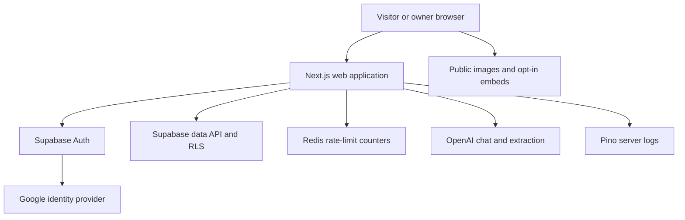
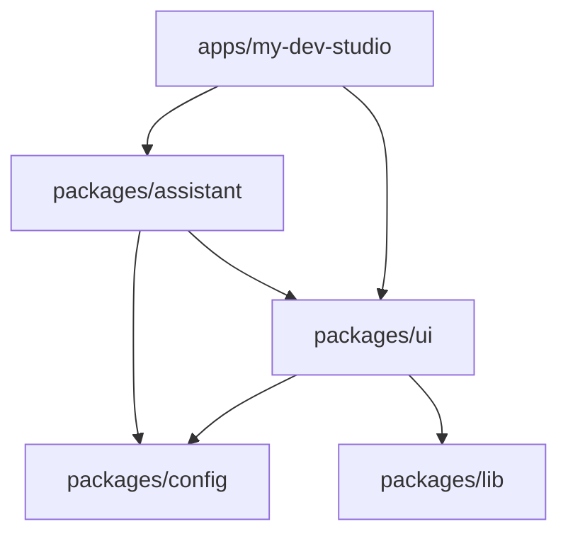
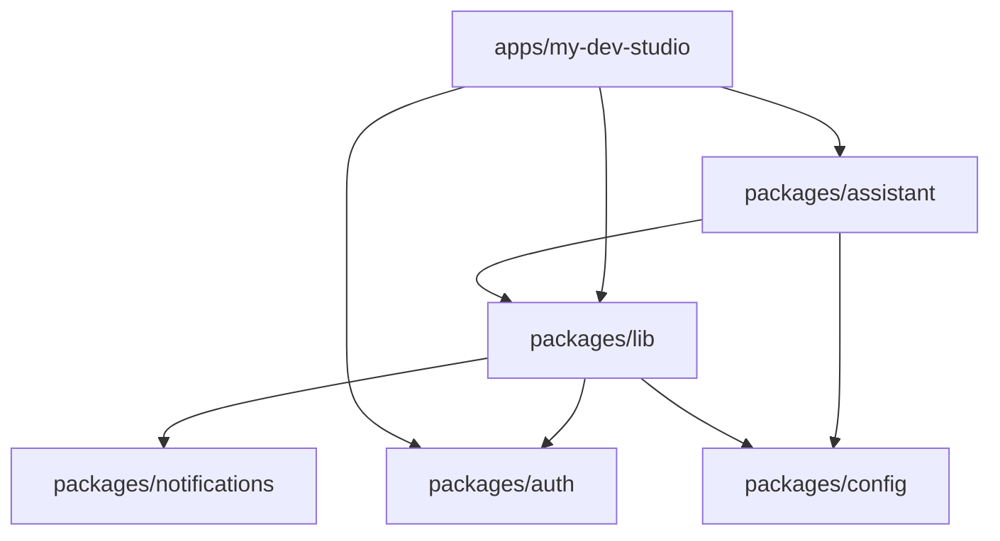
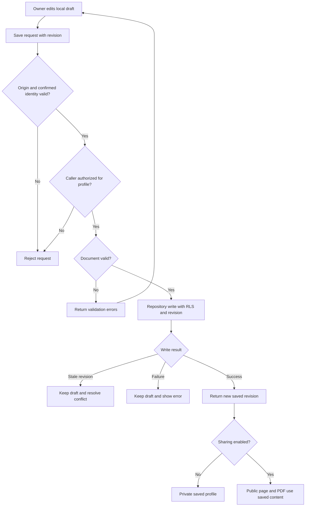
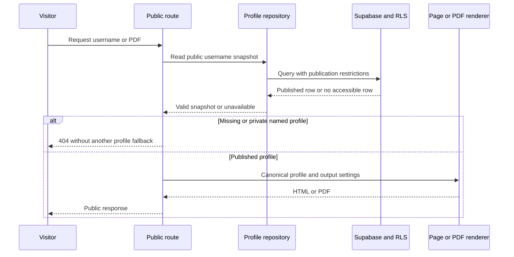
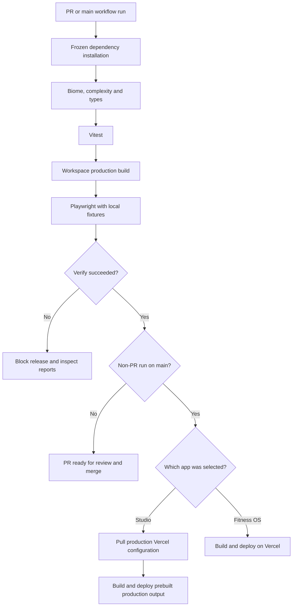

# Architecture

MyDevStudio is a Next.js App Router application in a pnpm/Turborepo monorepo. The repository retains the name `devhub-showcase`. This guide describes current source boundaries; it does not certify production provider or database configuration.

## Workspace ownership

| Package or directory                 | Owns                                                                                 | Keep out                                    |
| ------------------------------------ | ------------------------------------------------------------------------------------ | ------------------------------------------- |
| `apps/my-dev-studio`                 | Routes, API handlers, feature data access, metadata                                  | Duplicated portable UI                      |
| `apps/storybook-app`                 | Storybook for `@shared/ui`                                                           | Production routes                           |
| `packages/config`                    | Profile types, themes, section metadata, page copy                                   | Credentials and private database access     |
| `packages/lib`                       | Shared database access, repositories, services, domain models and validation schemas | Route-specific presentation                 |
| `packages/auth`                      | Shared browser/server authentication integration                                     | Portfolio content ownership decisions in UI |
| `packages/ui`                        | Shared controls, layouts, theme tokens and global CSS                                | Auth, routes and private repositories       |
| `packages/assistant`                 | Studio, portfolio and homepage compositions, PDF rendering, assistants and chat      | Ownership or publication authority          |
| `packages/utils`, `packages/runtime` | Logging and shared browser stores                                                    | Secrets or private payloads in telemetry    |
| `supabase/migrations`                | Schema and RLS change history                                                        | Implicit execution during app builds        |

`packages/lib/src` is organized into `db/`, `repositories/`, `services/`, `types/`, and `schemas/`. Within `services/` and `repositories/`, implementations and colocated tests are grouped into domain folders. Database connections and table definitions are shared across domains. App feature adapters bind verified identities, cookies and configuration. Publication/history/access, managed portfolios, resource/review access, Google IO and Fitness notification workflows/persistence live in this package. Chat entitlement/usage orchestration and Fitness assistant context/drafts live in `packages/assistant/src/services`. Existing domain exports remain available, while new direct imports can use `@shared/lib/repositories/profile` or `@shared/lib/services/task`. See the [services catalog](../packages/lib/CATALOG.md).

Shared compiler and Tailwind configuration live in their own packages. Packages expose explicit entry points; external versions are centralized in the workspace catalog.

## System context

Solid arrows show current runtime interactions. External integrations are optional; the Pino log stream is available without a hosted collector. Sentry is deliberately absent because it is not installed.

The browser owns display/interaction, but the server and database enforce access. Google proves identity through Supabase; it does not grant portfolio ownership. User-supplied media is fetched by the visitor, not the application server. OpenAI receives only the input permitted by the corresponding chat/import boundary.

## Package dependency diagrams

Arrows mean **imports/declares a dependency on**. These views show selected internal runtime dependencies from package manifests, not every external dependency or build-tool edge. `apps/my-dev-studio` composes both groups.

### Presentation and document packages

Section renderers, editors and PDF generation live in `packages/assistant` and use profile and section metadata from `packages/config`. Shared controls live in `packages/ui`.

### Services and authorization packages

No shared package imports `apps/my-dev-studio`. Authentication establishes identity; app guards, repositories and RLS decide resource access. See [observability](observability.md) for logging boundaries.

## Studio preferences and Job Hunter

The Studio account preferences route binds a verified account to appearance and companion settings. Published portfolio appearance stays in the saved profile and follows the publication flow.

The private Job Hunter page and API bind the signed-in workspace to job searches, matches and application records. Listing normalization and LinkedIn email parsing live in `packages/lib/src/services/jobs`. The scheduled worker and inbound email relay use dedicated routes and server configuration. Follow the [Job Hunter](testing/manual/job-hunter.md) and [LinkedIn alerts](testing/manual/linkedin-job-alerts.md) guides for prerequisites and verification.

## Profile save flow

A save is not automatically a publish operation. Publication follows the validated sharing setting. Concurrent edits require explicit recovery; the client must not silently retry by overwriting a newer revision.

## Public page and PDF read sequence

Authenticated private downloads use separate guarded routes. The main-profile fallback is explicit compatibility behavior, not a fallback for arbitrary usernames. Portfolio-only section settings and PDF inclusion remain independent.

## CI and release flow

Browser reports are uploaded for diagnosis. Database migrations and provider setup are separate operational changes; this workflow does not apply them.

## Routes and trust boundaries

| Route family                              | Responsibility                                |
| ----------------------------------------- | --------------------------------------------- |
| `/`                                       | Platform homepage                             |
| `/{username}`, `/{username}/cv.pdf`       | Published profile and PDF                     |
| `/{username}/edit`, `/admin`              | Authenticated personal studio and entry point |
| `/api/admin/profile`, `/api/admin/cv`     | Authenticated personal save/download          |
| `/admin/portfolios`, `/api/admin/managed` | Restricted managed-portfolio operations       |
| `/api/admin/cv-import`                    | Authenticated, limited CV extraction          |
| `/auth/callback`                          | Authentication callback                       |
| `/p/{id}`, `/p/examples/{slug}`           | Compatibility routes and public examples      |
| `/cv.pdf`                                 | Original main portfolio PDF                   |

Consult the actual route files for individual methods and response contracts. Database ownership and publication checks remain necessary even if the UI hides an action.

Managed portfolios are a separate administrator flow. Transfer requires explicit action, validated access and revision checks; it must not replace an edited or published recipient profile. See [managed portfolios](features/managed-portfolios.md).

## Rendering and runtime

Server components and handlers load permitted data. Client components own interactive state and editor controls. Keep client boundaries narrow and avoid importing server credentials or repositories into shared browser code.

PDFs are generated from normalized profile data using the shared CV package and its Handlebars/JSON template. Treat profile strings as data. Preserve the independent portfolio/PDF settings and visibility rules.

Saved AI knowledge has separate public and owner projections. The authorized editor can inspect saved knowledge without an LLM request; private owner knowledge is not public chat context. Public chat currently remains restricted to the main portfolio, reads its published snapshot on every request and does not enable premium chat for other accounts. See [AI foundation](features/portfolio-ai-foundation.md).

AI chat uses OpenAI with Redis rate limiting. CV extraction additionally has per-user and global limits. Missing optional services should produce the supported unavailable/fallback behavior without preventing a credential-free build.

## Persistence and security

Supabase is the database/auth integration; Prisma is not used. RLS complements server authorization. Installation, tests and builds do not apply production migrations. Revalidate historical deployment notes before provisioning or migrating an environment.

See [features](features.md) for user-visible behavior and [shared packages](reference/shared-packages.md) for reuse in another app.

See [security policy](../SECURITY.md), [personal workspaces](features/multiuser-cvs.md) and the [portfolio table RLS review](reference/portfolio-table-rls-review.md). Browser fixtures do not prove real OAuth or production RLS behavior.

## Change strategy

Prefer a vertical change across the existing type, validator, repository, adapter and renderer instead of introducing a parallel data model. Preserve earlier documents, absent-field defaults and established package exports. New dependencies require catalog and lockfile changes together. Use [testing](testing.md) to verify the affected boundary and [observability](observability.md) to define useful, non-sensitive failure signals.
