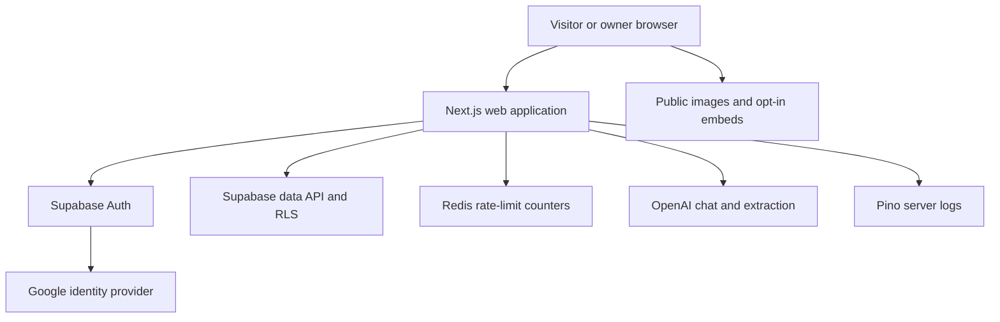
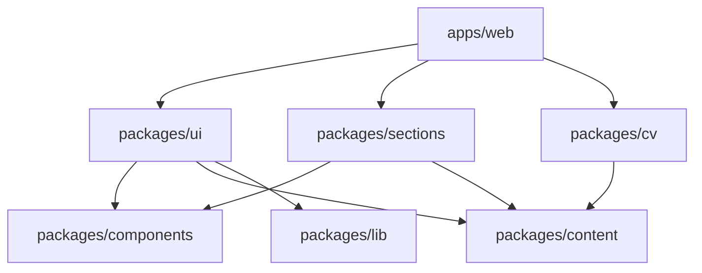
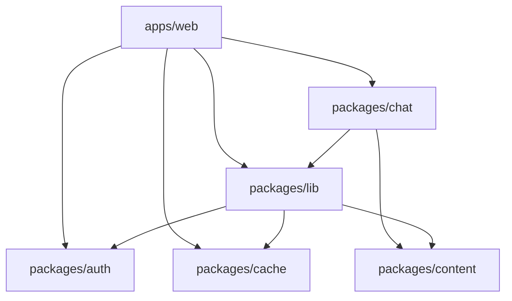
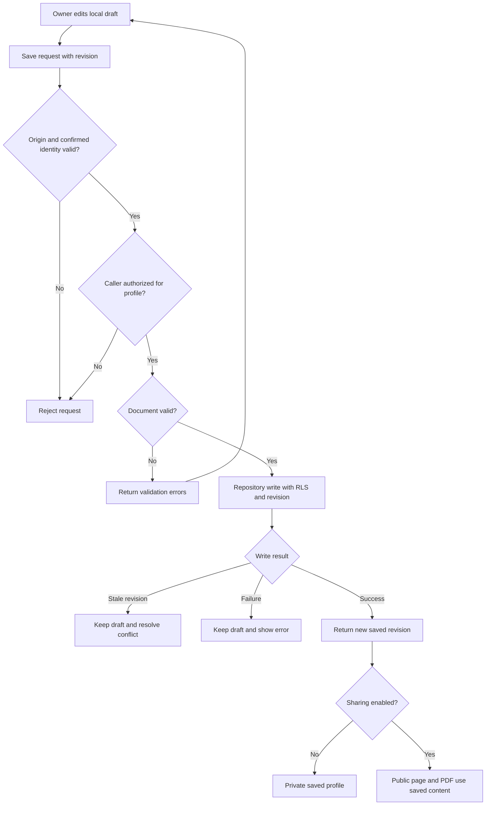
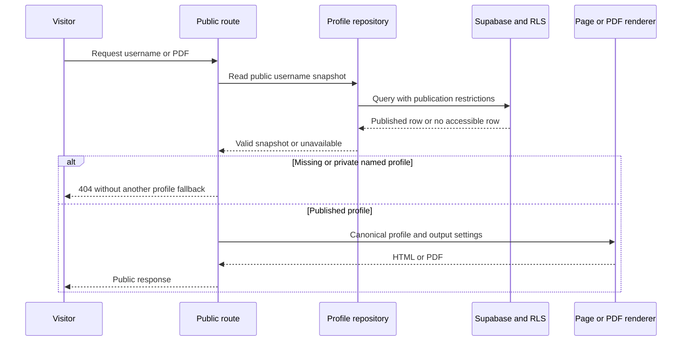
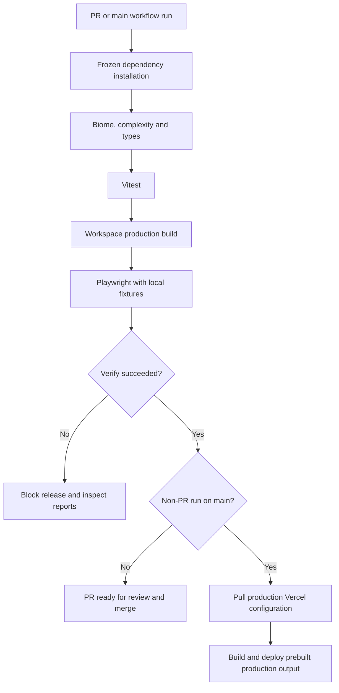

# Architecture

MyDevStudio is a Next.js App Router application in a pnpm/Turborepo monorepo. The repository retains the name `devhub-showcase`. This guide describes current source boundaries; it does not certify production provider or database configuration.

## Workspace ownership

| Package or directory             | Owns                                                                       | Keep out                                    |
| -------------------------------- | -------------------------------------------------------------------------- | ------------------------------------------- |
| `apps/web`                       | Routes, API handlers, app composition, metadata, data-access adapters      | Duplicated portable UI                      |
| `packages/content`               | Profile types, seed content, translations, themes, section metadata        | Credentials and private database access     |
| `packages/lib`                   | Validators, domain services, repository contracts and Supabase persistence | Route-specific presentation                 |
| `packages/auth`                  | Shared browser/server authentication integration                           | Portfolio content ownership decisions in UI |
| `packages/components`            | Portable UI primitives and reusable views                                  | Auth, routes and private repositories       |
| `packages/sections`              | Section definitions, public renderers and client editors                   | App-specific session and database logic     |
| `packages/ui`                    | Existing portfolio UI, styles, hooks and adapters                          | A second source of profile facts            |
| `packages/cv`                    | PDF normalization, layouts and templates                                   | Public bypasses for private downloads       |
| `packages/chat`                  | AI context, classification and response formatting                         | Ownership or publication authority          |
| `packages/cache`, `packages/log` | Redis integration and Pino logging                                         | Secrets or private payloads in telemetry    |
| `supabase/migrations`            | Schema and RLS change history                                              | Implicit execution during app builds        |

Shared compiler and Tailwind configuration live in their own packages. Packages expose explicit entry points; external versions are centralized in the workspace catalog.

## System context

Solid arrows show current runtime interactions. External integrations are optional; the Pino log stream is available without a hosted collector. Sentry is deliberately absent because it is not installed.

The browser owns display/interaction, but the server and database enforce access. Google proves identity through Supabase; it does not grant portfolio ownership. User-supplied media is fetched by the visitor, not the application server. OpenAI receives only the input permitted by the corresponding chat/import boundary.

## Package dependency diagrams

Arrows mean **imports/declares a dependency on**. These views show selected internal runtime dependencies from package manifests, not every external dependency or build-tool edge. `apps/web` composes both groups.

### Presentation and document packages

Portable components have no internal runtime package dependencies. Content defines shared data; section renderers/editors consume content and components. The older UI package also consumes lib adapters. The CV package consumes content without depending on app routes.

### Services and authorization packages

No shared package imports `apps/web`. Authentication establishes identity; app guards, repositories and RLS decide resource access. The standalone `packages/log` logger and the lib logger currently have separate factories; see [observability](observability.md).

## Profile save flow

A save is not automatically a publish operation. Publication follows the validated sharing setting. Concurrent edits require explicit recovery; the client must not silently retry by overwriting a newer revision.

## Public page and PDF read sequence

Authenticated private downloads use separate guarded routes. The main-profile fallback is explicit compatibility behavior, not a fallback for arbitrary usernames. Portfolio-only section settings and PDF inclusion remain independent.

## CI and release flow

Browser reports are uploaded for diagnosis. Database migrations and provider setup are separate operational changes; this workflow does not apply them.

## Routes and trust boundaries

| Route family                              | Responsibility                                |
| ----------------------------------------- | --------------------------------------------- |
| `/`                                       | Platform homepage                             |
| `/{username}`, `/{username}/cv.pdf`       | Published profile and PDF                     |
| `/{username}/edit`, `/admin`              | Authenticated personal studio and entry point |
| `/api/admin/profile`, `/api/admin/cv`     | Authenticated personal save/download          |
| `/admin/portfolios`, `/api/admin/managed` | Restricted managed-portfolio operations       |
| `/api/admin/cv-import`                    | Authenticated, limited CV extraction          |
| `/auth/callback`                          | Authentication callback                       |
| `/p/{id}`, `/p/examples/{slug}`           | Compatibility routes and public examples      |
| `/cv.pdf`                                 | Original main portfolio PDF                   |

Consult the actual route files for individual methods and response contracts. Database ownership and publication checks remain necessary even if the UI hides an action.

Managed portfolios are a separate administrator flow. Transfer requires explicit action, validated access and revision checks; it must not replace an edited or published recipient profile. See [managed portfolios](managed-portfolios.md).

## Rendering and runtime

Server components and handlers load permitted data. Client components own interactive state and editor controls. Keep client boundaries narrow and avoid importing server credentials or repositories into shared browser code.

PDFs are generated from normalized profile data using the shared CV package and its Handlebars/JSON template. Treat profile strings as data. Preserve the independent portfolio/PDF settings and visibility rules.

Saved AI knowledge has separate public and owner projections. The authorized editor can inspect saved knowledge without an LLM request; private owner knowledge is not public chat context. Public chat currently remains restricted to the main portfolio, reads its published snapshot on every request and does not enable premium chat for other accounts. See [AI foundation](portfolio-ai-foundation.md).

AI chat uses OpenAI with Redis rate limiting. CV extraction additionally has per-user and global limits. Missing optional services should produce the supported unavailable/fallback behavior without preventing a credential-free build.

## Persistence and security

Supabase is the database/auth integration; Prisma is not used. RLS complements server authorization. Installation, tests and builds do not apply production migrations. Revalidate historical deployment notes before provisioning or migrating an environment.

See [features](features.md) for user-visible behavior and [shared packages](shared-packages.md) for reuse in another app.

See [security policy](../SECURITY.md), [personal workspaces](multiuser-cvs.md) and the [legacy RLS review](legacy-rls-review.md). Browser fixtures do not prove real OAuth or production RLS behavior.

## Change strategy

Prefer a vertical change across the existing type, validator, repository, adapter and renderer instead of introducing a parallel data model. Preserve legacy documents, absent-field defaults and established package exports. New dependencies require catalog and lockfile changes together. Use [testing](testing.md) to verify the affected boundary and [observability](observability.md) to define useful, non-sensitive failure signals.
