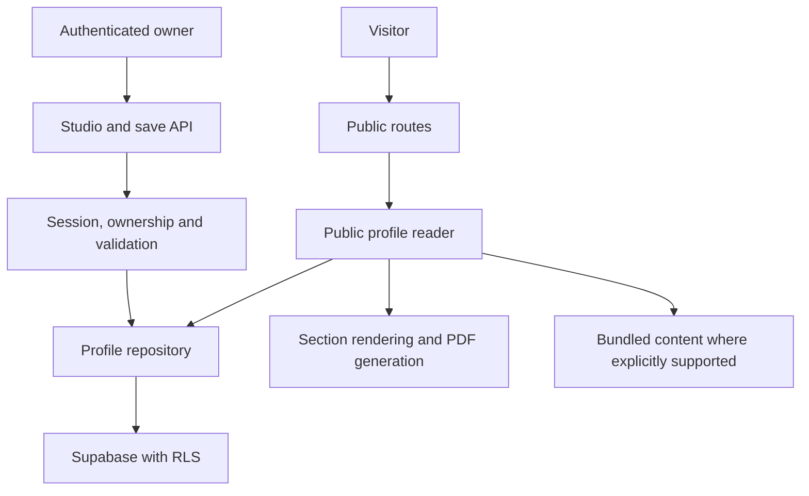

# Architecture

MyDevStudio is a Next.js App Router application in a pnpm/Turborepo monorepo. The repository retains the name `devhub-showcase`. This guide describes current source boundaries; it does not certify production provider or database configuration.

## Workspace ownership

| Package or directory | Owns | Keep out |
| --- | --- | --- |
| `apps/web` | Routes, API handlers, app composition, metadata, data-access adapters | Duplicated portable UI |
| `packages/content` | Profile types, seed content, translations, themes, section metadata | Credentials and private database access |
| `packages/lib` | Validators, domain services, repository contracts and Supabase persistence | Route-specific presentation |
| `packages/auth` | Shared browser/server authentication integration | Portfolio content ownership decisions in UI |
| `packages/components` | Portable UI primitives and reusable views | Auth, routes and private repositories |
| `packages/sections` | Section definitions, public renderers and client editors | App-specific session and database logic |
| `packages/ui` | Existing portfolio UI, styles, hooks and adapters | A second source of profile facts |
| `packages/cv` | PDF normalization, layouts and templates | Public bypasses for private downloads |
| `packages/chat` | AI context, classification and response formatting | Ownership or publication authority |
| `packages/cache`, `packages/log` | Redis integration and Pino logging | Secrets or private payloads in telemetry |
| `supabase/migrations` | Schema and RLS change history | Implicit execution during app builds |

Shared compiler and Tailwind configuration live in their own packages. Packages expose explicit entry points; external versions are centralized in the workspace catalog.

## Data and presentation flow

Public reads must enforce publication. Named missing/private profiles must not return someone else's fallback content. The original main profile has a supported bundled fallback; it also supplies the original portfolio's AI context. Server-side adapters map content into presentation resources.

A save authenticates the caller, chooses the permitted workspace, validates the document and checks its revision before persisting. A stale revision is a conflict, not permission to overwrite. Changes to saved fields require compatible defaults at read/render time as well as validation at write/import time.

## Routes and trust boundaries

| Route family | Responsibility |
| --- | --- |
| `/` | Platform homepage |
| `/{username}`, `/{username}/cv.pdf` | Published profile and PDF |
| `/{username}/edit`, `/admin` | Authenticated personal studio and entry point |
| `/api/admin/profile`, `/api/admin/cv` | Authenticated personal save/download |
| `/admin/portfolios`, `/api/admin/managed` | Restricted managed-portfolio operations |
| `/api/admin/cv-import` | Authenticated, limited CV extraction |
| `/auth/callback` | Authentication callback |
| `/p/{id}`, `/p/examples/{slug}` | Compatibility routes and public examples |
| `/cv.pdf` | Original main portfolio PDF |

Consult the actual route files for individual methods and response contracts. Database ownership and publication checks remain necessary even if the UI hides an action.

Managed portfolios are a separate administrator flow. Transfer requires explicit action, validated access and revision checks; it must not replace an edited or published recipient profile. See [managed portfolios](managed-portfolios.md).

## Rendering and runtime

Server components and handlers load permitted data. Client components own interactive state and editor controls. Keep client boundaries narrow and avoid importing server credentials or repositories into shared browser code.

PDFs are generated from normalized profile data using the shared CV package and its Handlebars/JSON template. Treat profile strings as data. Preserve the independent portfolio/PDF settings and visibility rules.

Saved AI knowledge has separate public and owner projections. The authorized editor can inspect saved knowledge without an LLM request; private owner knowledge is not public chat context. Public chat currently remains restricted to the main portfolio, reads its published snapshot on every request and does not enable premium chat for other accounts. See [AI foundation](portfolio-ai-foundation.md).

AI chat uses OpenAI with Redis rate limiting. CV extraction additionally has per-user and global limits. Missing optional services should produce the supported unavailable/fallback behavior without preventing a credential-free build.

## Persistence and security

Supabase is the database/auth integration; Prisma is not used. RLS complements server authorization. Installation, tests and builds do not apply production migrations. Revalidate historical deployment notes before provisioning or migrating an environment.

See [security policy](../SECURITY.md), [personal workspaces](multiuser-cvs.md) and the [legacy RLS review](legacy-rls-review.md). Browser fixtures do not prove real OAuth or production RLS behavior.

## Change strategy

Prefer a vertical change across the existing type, validator, repository, adapter and renderer instead of introducing a parallel data model. Preserve legacy documents, absent-field defaults and established package exports. New dependencies require catalog and lockfile changes together. Use [testing](testing.md) to verify the affected boundary and [observability](observability.md) to define useful, non-sensitive failure signals.
