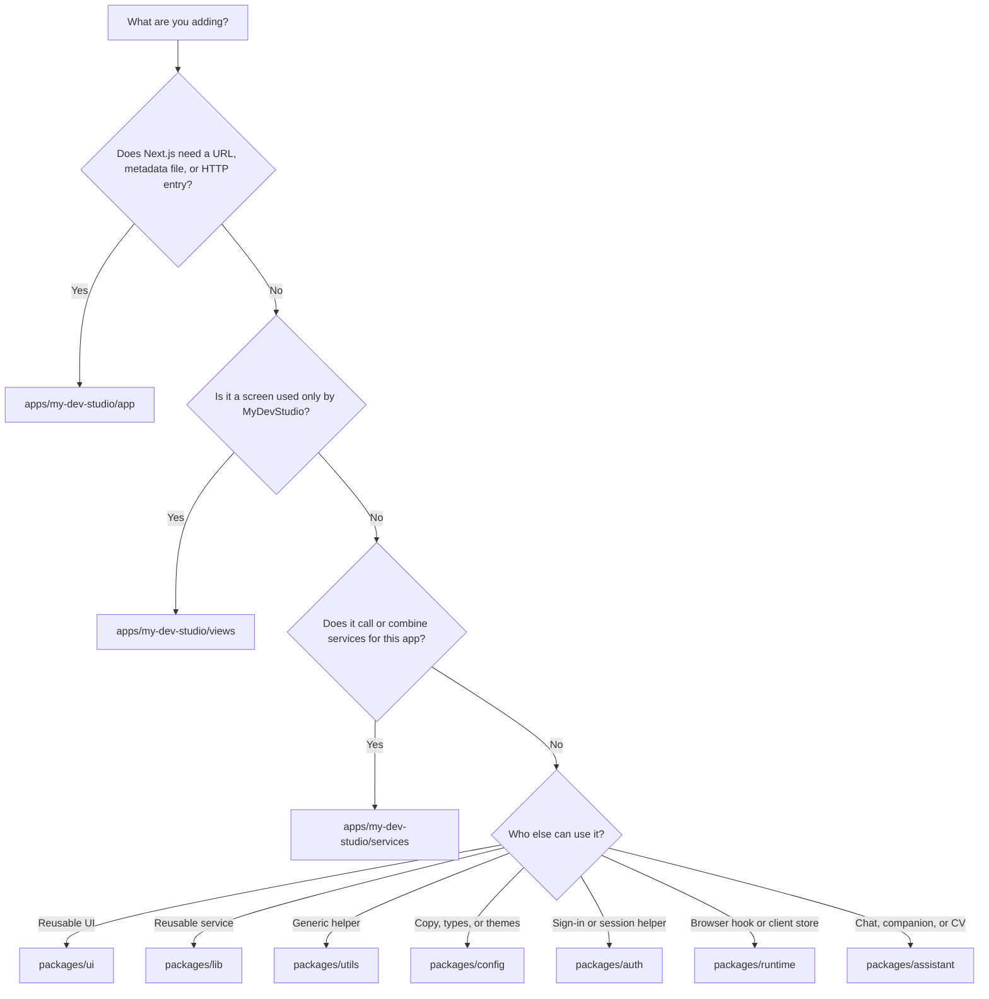

# Engineering conventions

## When to read

Read this before adding a file, a dependency, a TypeScript module, a React component, or a validation boundary. It covers where MyDevStudio code lives, Node and pnpm versions, Biome, package exports, and how untrusted input is checked. Use [AGENTS.md](../AGENTS.md) for agent workflow, [architecture](architecture.md) for package trust boundaries, and [testing](testing.md) for verification.

## Where code goes

These rules apply to `apps/my-dev-studio` (package name `my-dev-studio`). Stop at the first match. Package trust boundaries stay in [architecture](architecture.md).

### `app/` — routes only

`apps/my-dev-studio/app` is the App Router tree. A file belongs here when Next.js has to see it as a URL, a metadata file, or an HTTP entry.

Keep these files, and the route-group or dynamic folders that hold them:

| File                                                                                     | Role                          |
| ---------------------------------------------------------------------------------------- | ----------------------------- |
| `page.tsx`                                                                               | Server entry for one URL      |
| `route.ts`, `route.tsx`                                                                  | HTTP handler                  |
| `actions.ts`                                                                             | Server actions for that route |
| `layout.tsx`, `template.tsx`, `loading.tsx`, `error.tsx`, `not-found.tsx`, `default.tsx` | Page variants                 |
| `sitemap.ts`, `robots.ts`, icons, Open Graph images                                      | Route metadata                |

A route file stays thin. It reads params, calls `services/`, and renders a view from `views/` or a shared package. Request parsing and status codes can stay in `route.ts`. Screen markup, domain workflows, cookie wiring, and reusable helpers stay out of `app/`.

Colocate `page.test.tsx`, `route.test.ts`, and `actions.test.ts` with the route file.

This app has no `lib` folder. There is no `apps/web` package. Do not add a new `features/` tree. The removed home, reviews, portfolio, platform, and chat feature folders stay removed. Their bindings live in `services/<domain>`.

### `views/` — Studio-only screens

`apps/my-dev-studio/views` holds page and view components that exist for MyDevStudio. Group them by domain, for example `views/home`, `views/published`, and `views/user`.

A view receives already loaded data, links, and callbacks. The route, or a module in `services/`, loads that data. Import controls from `@shared/ui/{folder}`. Colocate `*.test.tsx` and `*.stories.tsx` with the view.

A screen that another app or a portable Storybook surface would reuse belongs in `packages/ui`, not here.

### `packages/ui` — reusable interface

Reusable components, views, sections, layouts, theme tokens, and global CSS live in `packages/ui` (`@shared/ui`). Check [packages/ui/CATALOG.md](../packages/ui/CATALOG.md) before adding markup. Import a control as `@shared/ui/{folder}`.

Auth, database access, and route handlers stay out of this package. Chat, companion, assistant workflows, and CV rendering stay in `packages/assistant` (`@shared/assistant`). A composition shared across apps stays there. A composition only MyDevStudio renders stays in `views/`.

### `services/` — app use of services

`apps/my-dev-studio/services` holds this app's use of a service, and combinations of services. That includes API functions, server functions, and the wiring that binds a shared service to this app's session, cookies, environment, and navigation.

Group modules by domain (`services/portfolio`, `services/admin`, `services/jobs`, `services/management`). Name the file for what it exports, such as `get-profile.ts`. Routes import these modules. Colocate the test with the module.

A workflow that another app or a shared package would call belongs in `packages/lib`. A file that only re-exports a shared package does not belong here.

Workspace auth and managed-portfolio access live in `services/admin` and `services/management`. Billing, jobs, calendar, publication, profile history, CV, chat, review, account, site, and home bindings live in the matching `services/<domain>` folder.

### `packages/lib` — reusable services

Reusable services, repositories, validation, typed database clients, and the Redis cache live in `packages/lib` (`@shared/lib`).

`packages/lib/src` is organized as `db/`, `repositories/`, `services/`, `types/`, and `schemas/`. Inside `services/` and `repositories/`, group implementations and tests by domain. Keep shared database code under `db/`. Export through the shallow entry points in [architecture](architecture.md). Import `Database`, `Json`, and row types from `@shared/lib/types`.

### `packages/utils` — reusable helpers

Generic functions with no portfolio, publication, or billing rules live in `packages/utils` (`@shared/utils`): logging, URL and date helpers, and other shared utilities. Localized portfolio copy and formatting stay in `packages/config`.

### Other shared homes

| Need                                               | Location                                           |
| -------------------------------------------------- | -------------------------------------------------- |
| Page copy, profile types, themes, section metadata | `packages/config` (`@shared/config`)               |
| Sign-in and session helpers                        | `packages/auth` (`@shared/auth`)                   |
| Browser hooks and client stores                    | `packages/runtime` (`@shared/runtime`)             |
| Assistant, chat, companion, and CV rendering       | `packages/assistant` (`@shared/assistant`)         |
| Web push delivery                                  | `packages/notifications` (`@shared/notifications`) |
| Trello board UI                                    | `packages/trello` (`@shared/trello`)               |
| Storybook for `@shared/ui`                         | `apps/storybook-app`                               |

Shared packages do not import `apps/my-dev-studio` or that app's env module. The app imports the package and passes verified identity, cookies, and configuration in.

### Examples

| You are adding                                         | Put it in                                                        |
| ------------------------------------------------------ | ---------------------------------------------------------------- |
| The `/studio/jobs` URL                                 | `app/studio/jobs/page.tsx`                                       |
| The jobs HTTP handler                                  | `app/api/jobs/route.ts`                                          |
| Server actions for that route                          | `app/studio/jobs/actions.ts`, or the route folder's `actions.ts` |
| Jobs screen markup used only by MyDevStudio            | `views/jobs/`                                                    |
| A button, section, or layout used in more than one app | `packages/ui`                                                    |
| Loading the signed-in owner's jobs for this app        | `services/jobs/`                                                 |
| Normalizing a job listing for every caller             | `packages/lib`                                                   |
| A date or URL helper with no domain rules              | `packages/utils`                                                 |
| FAQ or portfolio copy                                  | `packages/config`                                                |

## Tooling and dependencies

- Follow the Node engine and exact pnpm version in root `package.json`.
- Install with `pnpm install --frozen-lockfile`; keep one pnpm lockfile.
- Reference external dependencies with `catalog:` and pin versions in `pnpm-workspace.yaml`.
- Reference internal packages with `workspace:*` and maintain explicit export maps.
- Change the catalog, affected manifests and generated lockfile together.
- Use Biome for formatting, lint and import assistance. Do not add competing formatter/linter configuration or weaken complexity limits.
- Never hand-edit generated Next.js files or commit build output, reports, credentials or private exports.

## TypeScript and modules

Use the existing strict TypeScript configuration. Prefer explicit domain types and validated boundaries over assertions and `any`. Accept untrusted external data as unknown and validate it before use. Keep functions focused and reuse domain helpers instead of duplicating validation across routes.

Follow adjacent file naming and module structure. Export through package entry points; avoid reaching into another package's private implementation. Preserve useful server/browser boundaries and avoid circular dependencies.

## React and presentation

Keep server-side data access in app adapters and repositories. Add client boundaries only for browser interaction, hooks and state. Portable components must not depend on private data access, route-specific assumptions or authentication providers.

Reuse existing primitives, theme tokens, localization resources and section renderer/editor contracts. Preserve existing defaults and reduced-motion behavior. Use semantic controls, accessible names and visible focus. Handle loading, empty, error and mobile states deliberately.

Keep portfolio language/theme settings independent from PDF settings where the product provides separate choices.

## Domain changes and persistence

A new saved property needs its type, validator, import/save handling, default and renderer updated together. Preserve older documents when a field is absent. Validate URLs and other externally supplied values before rendering or using them.

Choose records from authenticated authority on the server. Never trust payload owner IDs, usernames or editable identity metadata to grant access. Keep publication explicit. Respect revision conflicts instead of silently overwriting newer work.

Database migrations are reviewed changes, not build side effects. Do not reintroduce Prisma or a second persistence path. Consult [SECURITY.md](../SECURITY.md) before changing ownership, publication, policies or transfer behavior.

## Errors and observability

Return actionable but non-sensitive failures. Expected validation errors, authorization denials and stale-revision conflicts are different from unexpected service failures. Handle errors at the boundary that can add useful context; avoid recording the same exception repeatedly.

Use existing Pino entry points for server logging and the field conventions in [observability](observability.md). Do not log request bodies, tokens, CV content or raw provider errors. A monitoring outage must not break a user operation.

## Tests, commits and documentation

Test behavior, especially denied access and earlier defaults. Keep test accounts and fixtures synthetic. Run the checks appropriate to the change and disclose anything blocked.

Prefer small commits with descriptive titles such as `docs: explain profile publication boundaries`. PRs explain the problem, resulting behavior, compatibility, verification and remaining setup. Update documentation with the behavior it describes and link to authoritative configuration rather than duplicating version lists that drift.
